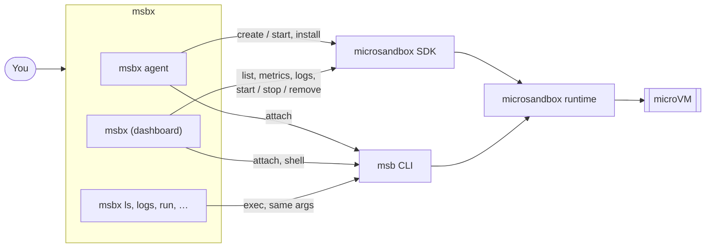

# How msbx works with microsandbox

msbx is a thin layer over an unmodified microsandbox. Its one long-running process is the
network proxy (`msbx proxy serve`), which sandboxes are created to use. It talks to
microsandbox in two ways:

- the microsandbox Rust SDK (pinned to 0.7.11) to list, create, start, stop and remove
  sandboxes, read their logs and metrics, and run the one-time agent install;
- the `msb` CLI on your `PATH` to attach a terminal (`msb exec -t`) and for every command msbx
  does not define.

## Why attach through `msb`

`msb exec -t` already handles the PTY, terminal resizing and raw mode, so msbx runs it with your
terminal attached. The dashboard suspends itself while you are
attached and redraws when `msb` exits.

## Why pass everything else through

msbx keeps no list of `msb` commands. On Unix, `msbx ls` replaces the msbx process with
`msb ls`, so output, signals and the exit code are exactly `msb`'s. New `msb` commands work
through msbx as soon as microsandbox ships them, and msbx never has to track `msb`'s flags.

## Finding the runtime

The SDK looks for its runtime only through `MSB_PATH` or `~/.microsandbox/bin`. Homebrew
installs `bin/msb` as a wrapper around `libexec/msb`, so msbx resolves the `msb` on your `PATH`
and points the SDK at the matching runtime binary. If you set `MSB_PATH`, it wins.

## How msbx recognises its sandboxes

msbx adds two labels when it creates a sandbox: `msbx.agent` and `msbx.project`. The dashboard
uses `msbx.agent` to decide what `Enter` runs, and `msbx agent` uses `msbx.project` to avoid
handing one project's sandbox to another folder with the same name. Sandboxes without these
labels are still listed, and `Enter` opens a shell in them.

## Scope

msbx does only what `msb` lacks. Features that belong in the runtime, the SDK or `msb` are
proposed upstream in microsandbox instead. Larger changes to msbx itself go through an
[RFC](../rfcs/README.md).
