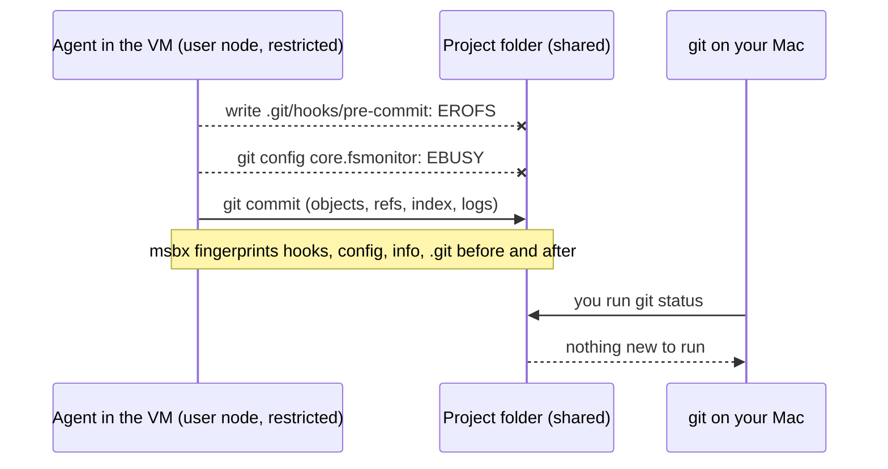

# RFC 0001: Git safety: stop agents running code on your Mac through git

- Status: Implemented
- Tracking issue: [#6](https://github.com/finngi/msbx/issues/6)

## Summary

msbx mounts your project read/write in the VM, `.git` included. An agent in the VM could write a git hook, or a git setting that names a command, and git on your Mac would run that command as you the next time you used git in that folder.

msbx now closes this with three layers:

1. Prevention in the VM. New sandboxes run the agent as the unprivileged user `node` under microsandbox's `restricted` security profile, and mount `.git/hooks`, `.git/info` and `.git/config` read-only inside a read-write `.git` mount. The agent can commit, branch and tag; it cannot write a hook, change a setting, or unmount the guards. Measured in a real VM, including as root.
2. Hardened git calls on the Mac. msbx runs git only through one helper that disables hooks, fsmonitor and config includes.
3. Detection. msbx records a fingerprint of the files git executes from before each session, warns about changes at the end of the session and at the next launch, and the dashboard shows a `git!` badge on a card whose project changed while no session was attached.

Sandboxes created before this change keep running as root without guards; msbx says so and tells you how to recreate them.

## Motivation

A VM is only a boundary if nothing crosses it. git crosses it: it reads files in the shared project folder and runs the commands they name, on the Mac, as the user. Other tools shipped this bug or now guard against it:

- Cursor shipped it as CVE-2026-26268, fixed in Cursor 2.5: "A malicious agent (ie prompt injection) could write to improperly protected .git settings, including git hooks, which may cause out-of-sandbox RCE next time they are triggered" ([MITRE record](https://cveawg.mitre.org/api/cve/CVE-2026-26268), [write-up](https://lilting.ch/en/articles/cursor-cve-2026-26268-git-hooks-sandbox-escape)).
- Pillar Security bypassed a sandbox rule that matched only the literal path `.git/config`: `git init --separate-git-dir .git-alt` leaves a `.git` *file* pointing at `.git-alt`, and `core.fsmonitor` in `.git-alt/config` ran when the editor's git extension ran `git status` ([Pillar Security](https://www.pillar.security/blog/git-directories-do-not-have-to-be-called-git)). Their conclusion: a sandbox has to find every git directory, whatever its name.
- Eclipse Theia had the same `core.fsmonitor` problem on opening an untrusted folder; the fix was to stop running git in untrusted workspaces at all ([Eclipse CVE work item](https://gitlab.eclipse.org/security/cve-assignment/-/work_items/231)).

Users should not have to audit `.git` after every session, msbx itself must never trigger a planted command, and when prevention cannot apply (older sandboxes) users must be told what changed.

## Guide-level explanation

Nothing changes in how you start an agent. What changes:

- In a new sandbox the agent runs as the unprivileged user `node`. `apt-get` and `sudo` do not work for the agent. To install a system package yourself, run `msbx exec -t -u root NAME -- bash` from your Mac (see [Guard git](../how-to/guard-git.md)).
- `git commit`, `branch`, `switch`, `tag`, `stash`, `reset` and `log` work in the VM as before. `git config` writes to the repository fail with `could not write config file .git/config: Device or resource busy`, so `git remote add`, `git branch --set-upstream-to` and a repo-local `git config user.email` fail too. Set identity with `git config --global`; msbx seeds the VM's global identity from your Mac's `user.name` and `user.email` on each start.
- At the end of each session, and again at the next launch, msbx prints a warning if a hook, a risky setting or the `.git` pointer changed, for example:

```text
warning: git files changed during this session in /Users/you/dev/app:
  .git/hooks/pre-commit (new)
  .git/config: core.fsmonitor = ./tools/watch.sh (new)
git on your Mac runs what these name, even from `git status`. Do not run git in this folder yet; read the files as data from outside it:
  cd / && env -i PATH=/usr/bin:/bin GIT_CONFIG_NOSYSTEM=1 GIT_CONFIG_GLOBAL=/dev/null /usr/bin/git --no-pager config --file '/Users/you/dev/app/.git/config' --no-includes --null --list | od -c
  od -c '/Users/you/dev/app/.git/hooks/<name>'
```

The warning never suggests a git command on the project: experiments 6 and 7 below show `git status` with `core.hooksPath=/dev/null -c core.fsmonitor=false` running a planted clean filter (on an index refresh) and `core.hooksPath=/dev/null` leaving config-defined hooks (`hook.<name>.command`, git 2.54+) running. Only `git config --file F --no-includes --null --list` is known to execute nothing; piping through `od -c` keeps a planted value from redrawing the terminal, and msbx escapes control characters in its own output the same way.

- The dashboard card shows `git!` in red when the project's git files changed since the last session started, and the Overview's `git` row lists what changed. The row reads `guarded` for a new sandbox and `not guarded (created before git guards; recreate with msb rm -f NAME)` for an older one.
- `msbx agent` on an older sandbox prints `note: NAME was created before git guards; the agent runs as root and can change .git/hooks and .git/config; recreate it with msb rm -f NAME`.

## Reference-level explanation



### What git executes from a repository

Reviewed against the git 2.56.0 manual on this machine (`man git-config`, `man githooks`, `man gitrepository-layout`); page anchors on git-scm.com carry the same text.

| Where | What runs | Source |
|---|---|---|
| `$GIT_DIR/hooks/*`, or `core.hooksPath/*` | Hook programs with the executable bit set, 28 events | [githooks](https://git-scm.com/docs/githooks): "By default the hooks directory is `$GIT_DIR/hooks`, but that can be changed via the `core.hooksPath` configuration variable" |
| `hook.<name>.command` + `hook.<name>.event` (git 2.54+) | "The value can be an executable path or a shell oneliner" | [git-config](https://git-scm.com/docs/git-config#Documentation/git-config.txt-hookltfriendly-namegtcommand) |
| `core.fsmonitor` | Runs the named hook on `git status` ("fsmonitor-watchman"), or the built-in daemon when `true` | git-config, githooks `fsmonitor-watchman` |
| `core.sshCommand`, `core.gitProxy`, `core.askPass`, `core.editor`, `core.pager`, `core.alternateRefsCommand`, `sequence.editor`, `interactive.diffFilter` | Commands run in place of ssh, as a proxy, as the editor or pager, by `rebase -i`, by `add -p` | git-config |
| `diff.external`, `diff.<driver>.command`, `diff.<driver>.textconv`, `merge.<driver>.driver`, `filter.<driver>.clean`, `.smudge`, `.process` | Driver commands, selected per path by `.gitattributes` and `.git/info/attributes` | git-config, [gitattributes](https://git-scm.com/docs/gitattributes) |
| `credential.helper`, `credential.<url>.helper` | "if preceded by !, shell commands" | git-config |
| `alias.*` | An alias starting with `!` runs a shell command | git-config |
| `gpg.program`, `gpg.<format>.program`, `gpg.ssh.defaultKeyCommand` | Signing and verification programs | git-config |
| `remote.<name>.uploadpack`, `remote.<name>.receivepack`, `remote.<name>.vcs`, `remote.<name>.proxy`, `core.gitProxy` | Programs run for a remote; with a local-path URL they run on this machine | git-config |
| `difftool.<tool>.cmd`, `mergetool.<tool>.cmd`, `browser.<tool>.cmd`, `man.<tool>.cmd`, `pager.<cmd>`, `web.browser`, `help.browser`, `instaweb.browser`, `sendemail.*Cmd`, `trailer.<token>.cmd` | Commands for tools the user may invoke | git-config |
| `gc.recentObjectsHook`, `uploadpack.packObjectsHook` | Hooks run by gc and upload-pack (`packObjectsHook` only from protected config) | git-config |
| `include.path`, `includeIf.<condition>.path` | Pull another config file in, which may hold any of the above | git-config "Includes" |
| `core.worktree`, `core.attributesFile`, `init.templateDir`, `submodule.<name>.update`, `url.<base>.insteadOf`, `http.proxy` | Redirect where git looks or sends data (no execution; listed for review) | git-config |
| `.git` file (`gitdir: <path>`) | Points the whole repository at another directory, with its own hooks and config | [gitrepository-layout](https://git-scm.com/docs/gitrepository-layout) |
| `commondir`, `config.worktree` | Linked-worktree pointer and per-worktree config | gitrepository-layout |

Git's own protection stops at ownership: `safe.directory` means "Git will refuse to even parse a Git config of a repository owned by someone else, let alone run its hooks", and "protected configuration" (system, global, command scopes) is honoured only for a few keys such as `safe.directory` and `uploadpack.packObjectsHook`. Files in the project are owned by the user, so on the Mac none of this applies. Git 2.45.1 hardened clones only ("Hooks are prevented from running during a clone", "Some protection is added for core.hooksPath while cloning"; [release notes](https://raw.githubusercontent.com/git/git/master/Documentation/RelNotes/2.39.4.adoc)). Git 2.54 to 2.56 added config-based hooks and did not add a per-repository "untrusted" mode ([2.54 notes](https://raw.githubusercontent.com/git/git/master/Documentation/RelNotes/2.54.0.adoc)).

### Prior art, exactly

- Codex (`codex-rs/linux-sandbox`, bubblewrap): "`--ro-bind / /`", writable roots re-bound read-write, then "protected subpaths" (`.git`, the resolved `gitdir:`, `.codex`) re-bound read-only; symlinks and missing protected paths get `/dev/null` mounted over them ([README](https://raw.githubusercontent.com/openai/codex/main/codex-rs/linux-sandbox/README.md)). The whole of `.git` is read-only, so the agent cannot commit inside the sandbox.
- Claude Code: denies writes to "`hooks` and `config` inside `.git`" in the working directory, and for a linked worktree to the same two in the shared `.git`, while `objects`, `refs` and the index stay writable; also denies a top-level `HEAD`, `objects`, `refs` and `config` so the folder cannot be turned into a bare repository, and deletes a newer top-level `HEAD`/`objects`/`refs` after a command ([Sandboxing](https://code.claude.com/docs/en/sandboxing)). When creating worktrees it skips the repository's filter drivers "because a filter driver is a shell command" and refuses to run when `.git/config` sets `lfs.customtransfer.<name>.path` or `lfs.standalonetransferagent` ([Worktrees](https://code.claude.com/docs/en/worktrees.md)). A path-based deny list; a June 2026 bug built the deny rules against the worktree root, so they missed `.git/` ([report](https://claudeissues.com/issue/66288-bug-sandbox-git-internals-write-protection-resolves-paths-against-the-worktree-r)).
- Cursor 2.5: the advisory says only that writes to `.git` settings were "improperly protected" before 2.5 ([GCVE](https://db.gcve.eu/vuln/CVE-2026-26268)); no mechanism is published.
- Docker Sandboxes (`sbx`): default mode mounts the working tree read-write with no git guard; `--clone` mode gives the agent a separate clone inside the sandbox, mounts the host repository read-only at `/run/sandbox/source`, and serves the clone back through a git daemon as the `sandbox-<name>` remote ([Use Git with sandboxes](https://docs.docker.com/ai/sandboxes/workflows/git.md)).
- VS Code and Theia: the git extension does not run in an untrusted workspace (Restricted Mode), which is what stopped `core.fsmonitor` from running on open ([Theia CVE](https://gitlab.eclipse.org/security/cve-assignment/-/work_items/231)). Codespaces runs `devcontainer.json` lifecycle commands on creation with no trust prompt ([Codespaces security](https://docs.github.com/en/codespaces/reference/security-in-github-codespaces)).
- git-lfs reads only an allow-list of keys from an in-repo `.lfsconfig` ("The set of keys allowed in this file is restricted for security reasons"); `lfs.customtransfer.*` and `lfs.standalonetransferagent` are not on it ([git-lfs-config](https://www.mankier.com/5/git-lfs-config)).

### What microsandbox 0.7.11 enforces (source and experiments)

Paths are under `~/.cargo/registry/src/*/`.

- Mount options: `MountBuilder::readonly` is "Enforced both at the host (virtiofs server rejects writes) and guest (kernel returns `EROFS`)" (`microsandbox-0.7.11/lib/sandbox/types.rs:397-403`); `noexec`, `nosuid`, `nodev`, `owner(uid, gid)` (`types.rs:405-470`). A bind of a host *file* becomes a single-file mount (`runtime/spawn.rs:2476-2515`, `launch_contract.rs:494`; needs runtime contract patch 16, msb 0.7.11 reports 18).
- Nested mounts are ordered parent first (`sandbox/builder.rs:5743` `builder_orders_nested_mounts_parent_first`); the same guest path twice is rejected (`types.rs:1281`).
- Sandbox user: `SandboxBuilder::user` (`builder.rs:660`), per-exec override `ExecOptionsBuilder::user` (`sandbox/exec/session.rs:212`), `msb exec -u`.
- `SecurityProfile::Restricted`: "Agentd sets `no_new_privs`, drops `CAP_SYS_ADMIN`, and forces `nosuid,nodev` on user mounts" (`microsandbox-types-0.7.11/lib/domain.rs:236-239`).
- No overlay or copy-on-write mount for a host directory is exposed by the SDK (`MountKind`: owned, bind, named, tmpfs, disk; `types.rs:70-80`).

Experiments on this Mac, msb 0.7.11, image `node:24-bookworm-slim`, a throwaway repository under the scratch folder, mounts `P` rw, `P/.git` rw, `P/.git/hooks` ro, `P/.git/info` ro, `P/.git/config` ro (file):

| # | Setup | Result |
|---|---|---|
| 1 | user `node`, `restricted` | Five virtiofs mounts appear nested in `/proc/mounts`, the inner ones `ro`. Host files surface as `node:node`; `a.txt` and `.git/objects/` are writable; `.git/hooks/pre-commit`, `.git/info/x` and `.git/config` give `Read-only file system`; `mv .git .git2`, `mv .git/hooks .git/h2` and replacing `config` give `Device or resource busy`; `rm -rf .git` removes everything *except* the guarded entries and `.git` itself; `umount` and `umount -l` give `must be superuser`; `unshare -Urm` then `umount` reports `not mounted` and the write still fails. |
| 1 | user `root` in the same VM | `CapEff 000001ffffdfffff` (bit 21, `CAP_SYS_ADMIN`, cleared); `umount .git/hooks`: `must be superuser`; `mount -o remount,rw`: `permission denied`; the hook write still fails. |
| 2 | user `node`, `restricted`, fresh repo | `sudo -n id` fails: "The no new privileges flag is set"; commit without identity gives the usual "Please tell me who you are"; `git config user.email` fails (`Device or resource busy`), `--global` works; `git commit`, `branch`, `switch`, `tag`, `stash`, `reset --hard` succeed and the Mac sees the commits; a commit touched only `COMMIT_EDITMSG`, `index`, `logs/HEAD`, `logs/refs/heads/main`, `objects/*`, `refs/heads/main`; `git remote add` fails (`could not set 'remote.o.url'`); `git branch --set-upstream-to` prints the config error but exits 0; `core.fsmonitor` and `core.hooksPath` cannot be set; `.gitattributes` is writable; `.git` cannot be replaced by a file (`Is a directory`). `codex --version` (0.148.0), `pi --version` (1.4.0) and `codex exec` start as `node`. |
| 3 | default profile, root (today's msbx) | `umount .git/hooks` exits 0, the hook write then succeeds, `umount .git/config` and `fsmonitor = /tmp/evil` appended; the Mac shows `.git/hooks/pre-commit` containing `evil` and the new setting. **Nested read-only mounts alone are no defence against root.** |
| 4 | file mount vs host rewrite | `git config` on the Mac (temp file + rename) and a new hook on the Mac are both visible in the VM at once. |
| 5 | the committed VM test without the proxy port (temporary edit) | `ensure` boots with the five guard mounts, user and profile stored; every write and unmount attempt by `node` and root fails as in experiment 1. |
| 6 | git 2.56.0 on the Mac, temp repo | `hook.attack.command` + `hook.attack.event = pre-commit` ran on `git -c core.hooksPath=/dev/null commit` (exit 0); `-c hook.pre-commit.enabled=false` stopped it. `env -i PATH=/usr/bin:/bin … /usr/bin/git config --file CONFIG --no-includes --null --list` with a planted `core.fsmonitor` listed 18 entries and ran nothing. A fake `git` first on `PATH` was run by plain `git` and ignored by `/usr/bin/git` under `env -i`. |
| 7 | git 2.56.0, planted `filter.attack.clean` + `*.txt filter=attack` | With `-c core.hooksPath=/dev/null -c core.fsmonitor=false`: `git status` after a content change left the filter alone; `git status` after a touch (index refresh) ran it, `git diff` ran it twice, `git add` ran it. No git command on the project is safe to recommend. |

Conclusion: a read-only mount nested in a writable one is enforced per mount by the guest kernel and the virtiofs server, but the outer mount still reaches the same host directory once the inner one is gone. The guard holds only when nobody in the VM can unmount: an unprivileged user (mounts from a parent namespace are locked, experiment 1) and a root without `CAP_SYS_ADMIN` (`restricted`, experiment 1). Both are used.

### Layers

| Layer | Closes | Residual risk |
|---|---|---|
| Agent as `node` under `restricted` | Unmounting or remounting the guards; `sudo`; setuid escalation | A kernel privilege escalation in the VM; agentd itself (runs as root with full capabilities) |
| `.git` as its own rw mount; `hooks`, `info`, `config`, `config.worktree`, `objects/info/alternates`, the `.git` file, a `core.hooksPath` directory and `include.path` files inside the project mounted read-only; the same for every submodule git dir under `.git/modules` (own rw mount, so it cannot be swapped out from under its read-only `.git` pointer file) | Writing hooks, settings, attributes, the gitdir pointer; renaming or deleting `.git` or the guarded entries (`EBUSY`) | Everything else in the worktree is writable: `.gitattributes` (harmless without a driver in your global config), `.lfsconfig` (`lfs.url` only), `.husky/` when `core.hooksPath` is not set yet, nested repositories the agent creates under the project (git on the Mac uses them only if you `cd` there) |
| Hardened host git helper (`hostgit.rs`): `/usr/bin/git` by absolute path, from `/`, with a cleared environment (`PATH=/usr/bin:/bin`, `GIT_ALLOW_PROTOCOL=`, `GIT_NO_LAZY_FETCH=1`, `GIT_OPTIONAL_LOCKS=0`, `GIT_TERMINAL_PROMPT=0`), `--no-pager -c core.hooksPath=/dev/null -c core.fsmonitor=false`; config reads add `GIT_CONFIG_NOSYSTEM=1`, `GIT_CONFIG_SYSTEM=/dev/null`, `GIT_CONFIG_GLOBAL=/dev/null` and `config --file F --no-includes --null --list`; the identity read keeps only `HOME` and `XDG_CONFIG_HOME` so it sees your global config | msbx running a planted command, or a planted `git` binary (a project on `PATH` through direnv) | None known; msbx only reads one named config file and your identity, and never runs a git command on the project |
| Fingerprint before and after each session, and against a stored baseline at launch and in the dashboard | Changes going unnoticed in older sandboxes, in the worktree copies of hooks, or through a hole in the layers above | Detection, after the fact; only the listed files; a change made and reverted between checks |
| Docs | Surprise | |

### Implementation

- `src/guard.rs` (pure, unit-tested with fixtures built by real `git`):
  - `repo(project) -> Option<Repo>`: `.git` directory, or a `.git` file parsed as `gitdir: <path>` (relative to the project); `Repo { git_dir, gitfile: Option<PathBuf> }`.
  - `mounts(project) -> Plan { guards, notes }`: the host paths to mount and whether read-only, in parent-first order, for the project's git dir and every submodule git dir under `.git/modules` (found by walking for folders holding `HEAD` and `config`; a module's working tree comes from its `core.worktree`): `git_dir` (rw), `hooks`, `info` (ro, created when missing), `config`, `config.worktree`, `objects/info/alternates`, the `.git` pointer file (ro, when present), plus `core.hooksPath` and `include.path` targets that resolve inside the project. When the git dir is outside the project (linked worktree, submodule checkout) there are no guards and a `note:` says so, through `sandbox::Notify`.
  - `snapshot(project) -> Snapshot`: BLAKE3 hash and executable bit of each file git executes from (the files above, every file in the hooks directories, for every git dir), and the risky settings of each config file read through the hardened helper. No file contents are stored: a config can hold credentials.
  - `changes(&before, &after) -> Vec<Change>` and `report(project, &changes) -> String`.
  - Baseline file: `$XDG_STATE_HOME/msbx/git-guard/<sandbox>.json` (serde_json, mode 600 via `paths::write_private`).
- `src/hostgit.rs`: `command()` (isolated, repository-config reads), `risky_settings(config)`, `identity()` (isolated, global config only), `is_risky(key, value)` with the table above plus `merge.tool`, `diff.tool`, `*.gpgSign`, `log.showSignature`, `gpg.*`, `extensions.*`, `remote.<n>.url`/`pushurl` (a URL chooses a transport helper), `submodule.<n>.url`, `sendemail.smtpServer`, `tar.<f>.command`, `alias.<n>.command`.
- `src/sandbox.rs`: `ensure` adds `.user("node")`, `.security(SecurityProfile::Restricted)`, one `.volume` per `Guard`, label `msbx.git=guarded`; the login volume and files move under `/home/node`; install and login-link scripts run as root through `shell_with(|o| o.user("root"))`; the link script `chown`s the shared file to the sandbox user; `prepare` seeds the VM's global git identity. The sandbox user and login mount come from the stored config, so older root sandboxes keep working.
- `src/main.rs` and `src/tui.rs`: `guard::Session::start` before attach (warns against the baseline, saves a new baseline), `finish` after (warns about the session). The dashboard refresh task compares each project with its baseline every tick and sets `App.git_changes`; `ui.rs` renders the badge and the `git` row.
- Tests: unit tests for `repo`, `mounts`, `snapshot`/`changes` (hooks added, removed, edited, mode bit; risky keys; gitdir file; hooksPath inside the project; include.path), `report`, the hardened command's arguments, identity parsing, the snapshot baseline round trip, the TUI `git!` badge and row; one `#[ignore]` real-VM test: the agent user cannot write `.git/hooks/x`, change `core.fsmonitor` or unmount the guards, even as root, but can `git commit`, and a hook planted on the host side is reported by `changes`.

## Drawbacks

- The agent cannot `apt-get`, `sudo`, `git remote add`, `git config` the repository or set upstream branches. The how-to explains `msbx exec -t -u root`.
- Older sandboxes keep root and no guards until recreated.
- Five mounts where there was one (six with a `config.worktree` or `.git` file, more with hooks-path or include targets); a project without `.git` keeps one.
- The baseline is per sandbox name, so two sandboxes for one project track it separately.

## Security

The threat is a prompt-injected agent, or a repository designed to attack its user. The VM is the isolation boundary; this RFC removes the known ways to cross it through git. Still open:

- Files git only *reads* (`index`, `objects`, `refs`, `packed-refs`) remain writable: the agent can rewrite history or corrupt the repository. That costs work; no code runs on the Mac.
- A hook directory outside `.git` that `core.hooksPath` names (husky's `.husky/_`) is mounted read-only only when the setting is already in `.git/config` when the sandbox is created.
- Anything the user runs on the Mac that reacts to project files (`package.json` scripts, `mise.toml`, `.vscode/tasks.json`) is out of scope.

## Rationale and alternatives

- Non-root agent (chosen): the only thing that makes nested read-only mounts hold; experiment 3 shows root unmounting them. Agents install packages with npm, pip or cargo into their own home; the first-use install still runs as root.
- `restricted` profile (chosen, in addition): covers a root exec session (`msbx exec -u root`) and `sudo` installed by the agent; no cost to the agents.
- Whole `.git` read-only, as Codex does (rejected): the agent could not commit; the brief requires `git add/commit/branch/log` to work.
- Read-only mounts only, agent still root (rejected): experiment 3.
- Repository only inside the VM with a git daemon, as sbx `--clone` (rejected for now): best isolation, but you lose the live files on the Mac and need a fetch step; possible later.
- Make the Mac's git ignore repository executables (rejected): repository config is read after global config and wins, so no global `includeIf` can neutralise `core.fsmonitor` or `core.hooksPath` set in `.git/config`; only `-c` or `GIT_CONFIG_*` on each command do, which means wrapping `git` for the user. The how-to documents an opt-in shell function; msbx leaves the user's git alone.
- Parsing `.git/config` in Rust (rejected): git's parser has quoting, continuation and include rules an attacker could exploit against a weaker reimplementation; `git config --file F --list -z --no-includes` through the hardened helper reads only.
- A `git_guard = false` setting (rejected): the check is cheap and only prints; no knob until someone needs one.
- Blocking nested repositories by name, as Claude Code's deny list does (rejected): git on the Mac only uses a nested repository if you `cd` into it; listed as residual risk.
- Storing full control-file contents in the baseline (rejected): a config can hold credentials; hashes and executable bits detect the same changes.
- Refusing to attach to sandboxes created before the guard (rejected): a user's running work would stop dead; the note on attach and the dashboard's `git` row say what to do, and detection still runs for them.
- Refusing projects whose guarded paths are symlinks or hard links, or whose object store uses alternates (rejected): a symlinked `.git/hooks` is mounted by the SDK with the symlink unfollowed (`follow_root_symlinks` is off) so the guard still binds the real folder; `objects/info/alternates` only redirects object reads, so it is mounted read-only. Linked worktrees and submodule checkouts as the project get a note and still start, since nothing is mounted for them and git does not run in the VM there.

## Prior art

See "Prior art, exactly" above; links: [Codex linux-sandbox](https://raw.githubusercontent.com/openai/codex/main/codex-rs/linux-sandbox/README.md), [Claude Code sandboxing](https://code.claude.com/docs/en/sandboxing), [Claude Code worktrees](https://code.claude.com/docs/en/worktrees.md), [Cursor CVE-2026-26268](https://db.gcve.eu/vuln/CVE-2026-26268), [Pillar Security](https://www.pillar.security/blog/git-directories-do-not-have-to-be-called-git), [Docker Sandboxes git](https://docs.docker.com/ai/sandboxes/workflows/git.md), [githooks](https://git-scm.com/docs/githooks), [git-config](https://git-scm.com/docs/git-config), [gitrepository-layout](https://git-scm.com/docs/gitrepository-layout).

## Unresolved questions

- Linked worktrees ([RFC 0007](0007-worktrees.md)): the shared `.git` is outside the project, so no guard applies (msbx prints a note) and git does not run in the VM; RFC 0007 should mount the common dir with the same guard list.
- A submodule added after the sandbox was created has no mounts until the sandbox is recreated; detection covers it.

## Future possibilities

- Guard `.git/modules/*` and linked worktrees.
- A clone mode with a git daemon, as sbx does.
- Config-based hooks (`hook.<name>.command`) make `.git/config` the only file to watch once hook directories go out of fashion.
