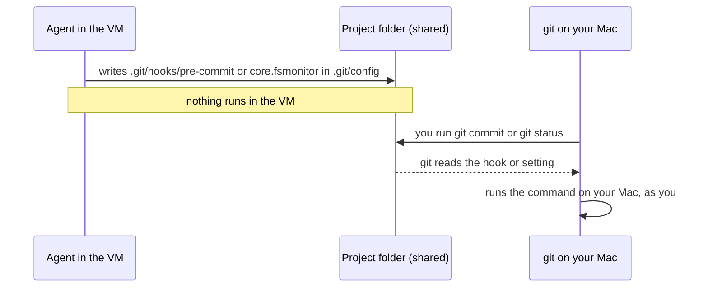

# RFC 0001: Git safety: stop agents running code on your Mac through git

- Status: Proposed
- Tracking issue: #TBD

## Summary

msbx mounts your project read/write in the VM, `.git` included. In the VM an agent can write a git hook, or a git setting with a command named in it. Nothing happens inside the VM. The command runs on your Mac, as you, the next time you do a `git commit`, a `git status` or something similar in that folder. That's exactly what the VM is supposed to prevent.

Other tools have shipped this bug:

- **Cursor:** CVE-2026-26268, fixed in Cursor 2.5. A sandboxed agent wrote `.git` hooks and config, and git ran them outside the sandbox ([write-up](https://lilting.ch/en/articles/cursor-cve-2026-26268-git-hooks-sandbox-escape)).
- **A related bypass:** Pillar Security used a git directory not named `.git` together with `core.fsmonitor` ([Pillar Security](https://www.pillar.security/blog/git-directories-do-not-have-to-be-called-git)).
- **Codex:** keeps `.git`, and the target of a worktree's `gitdir:` file, read-only in its workspace-write sandbox ([Codex sandboxing](https://developers.openai.com/codex/concepts/sandboxing)).
- **Claude Code:** its sandbox blocks writes to `.git/hooks` and `.git/config`. When it creates a worktree it does not run the repository's own filter drivers, "because a filter driver is a shell command" ([Claude Code worktrees](https://code.claude.com/docs/en/worktrees.md)).

## Motivation

msbx mounts the project, `.git` included, read-write into the VM. An agent there can put in a git hook or a setting such as `core.fsmonitor`, and the next time you use git in that folder on your Mac, git will run it. That defeats the purpose of running the agent in a VM.

Cursor shipped exactly this bug as CVE-2026-26268, and Codex and Claude Code now guard git data on purpose. Users should know about the risk, msbx itself should never trigger it, and users should be told when it may have happened.

## Guide-level explanation

- msbx never runs your repository's hooks or fsmonitor when it calls git itself.
- When an agent session ends, msbx tells you if git hooks or risky git settings changed during it, and lists them.
- Worktree runs (see [RFC 0007](0007-worktrees.md)) mount the shared git data so that the VM cannot change hooks or config.
- The README's security section states the risk plainly.

## Reference-level explanation



Git runs commands from these places in a repository:

- files in `.git/hooks/`, or in the folder `core.hooksPath` names (which can be inside the project, such as `.husky`)
- `core.fsmonitor`, which runs on `git status`
- `filter.<name>.clean`, `smudge` or `process`, used through `.gitattributes`
- `core.sshCommand`, `core.pager`, `core.editor`, `diff.external`, `credential.helper`, and `alias.*` values starting with `!`
- `include.path` and `includeIf`, which pull in another config file
- a `.git` file whose `gitdir:` line points at a git directory the agent planted

msbx uses several layers:

| Layer | What it does | Stops | When |
|---|---|---|---|
| README | States the risk in the security section | Surprise | Now |
| Safe git calls | msbx runs git with hooks and fsmonitor turned off, and creates worktrees without a checkout on the Mac | msbx itself running planted code | Now |
| Guard check | Records hooks, risky settings and git pointer files before a session, compares after, and warns | Changes going unnoticed | Now, on by default |
| Read-only git data | Worktree sandboxes get the shared git folder read-only; only objects, refs and logs are writable | Hook and config writes from worktree runs | With [RFC 0007](0007-worktrees.md) |

When the guard check finds a change, it prints:

```
warning: git files changed during this session in /Users/you/dev/app:
  .git/hooks/pre-commit (new)
  .git/config: core.fsmonitor = ./tools/watch.sh (new)
git runs these on your Mac. Review them before running git in this folder.
```

To look at the repository without running anything it planted:

```sh
git -c core.hooksPath=/dev/null -c core.fsmonitor=false status
```

Turn the check off in `~/.config/msbx/config.toml` with `git_guard = false`.

### Implementation notes

- Every host git call goes through one helper that adds `-c core.hooksPath=/dev/null -c core.fsmonitor=false`.
- `guard::snapshot(project) -> Fingerprint`:
  - Reads the hooks folder (resolved before the session), the `.git` file or `.git/config`, `config.worktree` and `commondir`.
  - Stores contents, not hashes, so no new dependency is needed.
- `guard::changes(&before, &after) -> Vec<Change>` is a pure function and unit-tested. Risky keys come from `git config --file <path> --list -z`, which reads only.
- `main.rs` and the TUI's create/attach both call one shared function: snapshot, `attach::exec`, snapshot, warn.
- Config key `git_guard` (bool, default `true`).
- Tests:
  - unit tests for `changes` with added, removed and edited hooks and keys
  - a `#[ignore]` real-VM test that writes a hook from the VM and checks the warning.

## Drawbacks

- The guard check detects changes. It does not prevent them.
- The VM keeps running after you detach. Changes made while no session is attached are not caught.
- In a normal run (not a worktree), `.git` must stay writable or the agent cannot commit, so the read-only layer cannot apply there.
- Read-only folders mounted inside a writable mount do not help either: the agent is root in the VM and can unmount them.
- The check knows only the settings listed above.
- The check does not cover other files that tools on your Mac run: `.husky/`, `.vscode/tasks.json`, `mise.toml` env and hooks, or `package.json` scripts you run yourself.

## Security

The threat is a prompt-injected agent, or a repo designed to attack you. The VM is your isolation barrier, and this work closes the main known loophole around it. It doesn't make using git on agent-written repos safe in general: review before you run.

## Rationale and alternatives

- **Guard check (chosen, on by default):** cheap, deterministic and no new dependencies. Works for every run. It detects changes but does not prevent them, and misses changes made while no session is attached.
- **Read-only `.git` (chosen for worktree runs only):** in a normal run, `.git` must stay writable for commits, and read-only mounts nested inside a writable one can be unmounted by the root agent. In worktree runs the shared git folder can be mounted read-only, and that is enforced on the Mac.
- **Repository only inside the VM, fetched back (rejected for now):** isolates best. You lose live files on the Mac, and it needs a way to transfer commits back.
- **Non-root agent (rejected for now):** would make nested read-only mounts hold. But agents expect to install packages, and `.git/config` still has to be writable.
- **Hardened host git calls (chosen):** small change. Without it, msbx creating a worktree could itself run a planted hook.
- **Not doing it:** any prompt-injected agent can run code on your Mac with your user account, and the README's security section understates this.

## Prior art

- [Cursor CVE-2026-26268](https://lilting.ch/en/articles/cursor-cve-2026-26268-git-hooks-sandbox-escape): an agent wrote git hooks and config, and they ran on the host.
- [Pillar Security](https://www.pillar.security/blog/git-directories-do-not-have-to-be-called-git): the same escape through a git folder not named `.git`, plus `core.fsmonitor`.
- [Codex](https://developers.openai.com/codex/concepts/sandboxing): `.git`, and the target of `gitdir:`, are read-only in workspace-write mode.
- [Claude Code](https://code.claude.com/docs/en/worktrees.md): blocks writes to `.git/hooks` and `.git/config`, and does not run repository filter drivers when creating worktrees.

## Unresolved questions

- Should the guard keep a stored baseline, so changes made while no session is attached are caught at the next launch?
- Which settings belong on the risky list? It needs a short reviewed list, not every config key.
- Should the TUI also run the check and show a badge on the card?
- Should repositories using husky (`core.hooksPath` inside the project) get a specific note, since their hooks are always writable from the VM?

## Future possibilities

- Keeping the repository only inside the VM and fetching results back. This isolates best, but you lose live files on the Mac.
- Running agents as a non-root user in the VM.
- Wrapping or blocking git on the Mac.
- A warning badge in the TUI.
