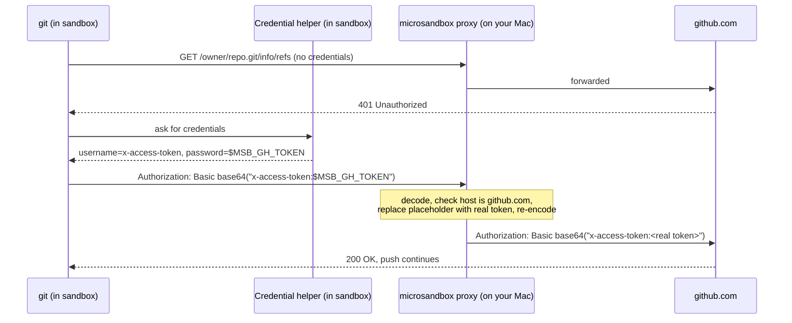

# RFC 0003: GitHub access for agents

- Status: Proposed
- Tracking issue: [#8](https://github.com/finngi/msbx/issues/8)

## Summary

Agents in msbx sandboxes can clone, pull and push to GitHub over HTTPS. Your token stays on your Mac. Only a placeholder ever appears in the sandbox. The microsandbox network proxy puts the actual token in place of the placeholder, and only on requests to `github.com` and `api.github.com`.

## Motivation

Agents can edit and commit in a sandbox, but they can't pull or push private GitHub repositories, so you have to finish every task by hand on the host. The most obvious fix, putting a token in the sandbox, makes it available to any code the agent runs, including code a prompt injection tricked it into running.

microsandbox can already keep a secret on the host and insert it only on requests to chosen hosts. This design uses that, so git and `gh` work from the sandbox while the token stays on your Mac, limited to the repositories you choose.

## Guide-level explanation

- `git clone`, `git fetch`, `git pull` and `git push` work inside the sandbox for the repositories your token covers.
- Remotes written as SSH URLs (`git@github.com:owner/repo`) also work. Inside the sandbox only, git sends them over HTTPS.
- The `gh` CLI works if it is installed in the sandbox, because it reads `GH_TOKEN`.
- Commits use your git name and email from the host, unless you set `[git]` in the config.
- The dashboard shows which repository the sandbox can reach, for example `github  finngi/msbx · GH_TOKEN (host-side)`.
- Nothing changes until you set `MSBX_GITHUB_TOKEN`. If it is unset in a GitHub repository, msbx prints a link for creating a token.

### Setup

1. Create a fine-grained token. Open https://github.com/settings/personal-access-tokens/new?name=msbx&description=msbx+agent+access&expires_in=30&contents=write&pull_requests=write
   - Under "Repository access", choose "Only select repositories" and pick the repositories the agent should work on. The link cannot preselect them.
   - When you run msbx in a GitHub repository without a token set, it prints this link with the owner and repository name filled in.
2. Store the token in the macOS Keychain. This command prompts for it:
   ```sh
   security add-generic-password -a "$USER" -s msbx-github -w
   ```
3. Export it in your shell profile (`~/.zshrc`):
   ```sh
   export MSBX_GITHUB_TOKEN="$(security find-generic-password -a "$USER" -s msbx-github -w 2>/dev/null)"
   ```
4. Open a new terminal and run `msbx agent codex`. A sandbox created before you set the token has no GitHub access: remove it with `msb rm -f <name>` first.

You also need to set the variable in any shell you use for `msb start` on that sandbox. Without it the sandbox won't start. If you'd rather remove GitHub access from the sandbox, run `msb modify <name> --secret-rm GH_TOKEN`.

Other choices, in `~/.config/msbx/config.toml`:

- A different token for one project: `[projects."/path"]` with `github = { token_env = "MSBX_GITHUB_TOKEN_ACME" }`.
- Your `gh` login, which is much broader: `[github] token_env = "GH_TOKEN"` plus `export GH_TOKEN="$(gh auth token)"`.
- Turn GitHub access off: `[github] enabled = false`.

## Reference-level explanation



If the placeholder is sent to any other host, the proxy blocks the request.

Details:

- msbx reads the token from `MSBX_GITHUB_TOKEN` each time the sandbox starts. It is never stored in microsandbox's database.
- Inside the sandbox, `GH_TOKEN` contains only the placeholder `$MSB_GH_TOKEN`.
- git settings (credential helper, SSH-to-HTTPS rewrite, identity) are passed as environment variables. msbx writes nothing to the repository's `.git/config`, which your Mac shares.

### Implementation notes

- New module `src/github.rs`, mostly pure functions:
  - `repo_slug(remote) -> Option<String>`
  - `token_link(slug) -> String`
  - `guest_git_env(project, identity, github: bool) -> Vec<(String, String)>`
  - `host_git(project, args) -> Option<String>`, which runs host `git config` and `git remote get-url origin` through `tokio::process`
- Secret, in `sandbox::ensure`:
  ```rust
  .secret(|s| s.env("GH_TOKEN")
      .source(SecretSource::env(token_env))
      .allow("github.com").allow("api.github.com")
      .substitute_in_header_fields(["authorization"])
      .allow_placeholder_for(agent_api_host))
  ```
  The proxy already decodes and re-encodes Basic auth, over both HTTP/1 and HTTP/2. Restricting substitution to `authorization` stops other headers echoing the token back.
- Guest git config goes in `GIT_CONFIG_COUNT` / `GIT_CONFIG_KEY_n` / `GIT_CONFIG_VALUE_n`:
  - `credential.https://github.com.helper`
  - `url.https://github.com/.insteadOf=git@github.com:`
  - `safe.directory=<project>`
  - `user.name` and `user.email`
- Add the label `msbx.github=<owner/repo>` and the field `SandboxInfo.github` for the dashboard row.
- Why only environment variables: the SDK reads `SecretSource::Env` in the process that starts the VM, store-backed sources are unsupported, and `set_var` needs `unsafe`, which the crate forbids.
- Tests:
  - unit tests for `repo_slug` (https, scp-style and `ssh://` forms), `guest_git_env` and `token_link`
  - a snapshot of the dashboard row
  - an `#[ignore]` VM test:
    - `git ls-remote` and `git push` work against a throwaway repository
    - no token value appears in `env` inside the sandbox
    - the placeholder sent to another host returns 403
    - git trusts the proxy CA without running `/msb-trust.sh`

## Drawbacks

This design has no separate list of limits. Its costs and trade-offs are covered under [Security](#security) ("What this does not stop") and [Rationale and alternatives](#rationale-and-alternatives).

## Security

- **What the agent can do with the token.** Anything the token allows on the selected repositories. That includes pushing to any branch, force-pushing, deleting branches and opening pull requests.
- **Protect your default branch** with a ruleset: require pull requests, and block force pushes and deletions. See https://docs.github.com/en/repositories/configuring-branches-and-merges-in-your-repository/managing-rulesets/about-rulesets
- **Grant only what the agent needs.** Contents and Pull requests are enough. Leave everything else unselected, including the Workflows permission. GitHub recommends choosing "the minimal permissions necessary" and setting an expiry: https://docs.github.com/en/authentication/keeping-your-account-and-data-secure/managing-your-personal-access-tokens
- **Keep the 30-day expiry.** To rotate, update the Keychain item. The new token is used the next time the sandbox starts.
- **The token cannot be read inside the sandbox.** Code there sees only the placeholder. The proxy blocks any request that carries the placeholder to a host other than GitHub. The one exception is the agent's own API host (for example `api.openai.com`), which may receive the unchanged placeholder so that chat messages quoting it are not blocked. It never receives the token.
- **What this does not stop:**
  - The agent can still send your code to any host the network settings allow.
  - The agent can write to the project's `.git` folder, including hooks and local git config, and git on your Mac runs those. After an agent session, check `.git/hooks` and `git config --local --list` before running git on the host.
- **The opt-in `gh` token** can reach every repository you can. Its default scopes include `repo`, `read:org` and `gist`, and some logins also have `workflow`. Use it only for sandboxes you trust.

## Rationale and alternatives

| Option | Setup | What it can touch | Chosen |
|---|---|---|---|
| Fine-grained token for selected repositories | Create a token once | Only the repositories you pick, only the permissions you grant | Default |
| Your `gh` login token (`gh auth token`) | None | Every repository you can access. Often also gists, org data and CI workflows | Opt-in |
| GitHub App installation token | Create an App, manage its key, refresh every hour | The repositories the App is installed on | No |
| Forward your SSH agent into the sandbox | Install socat in the sandbox | Every key in your agent and every server those keys open | No |

- **Fine-grained token for selected repositories (chosen default):** one-time setup (msbx prints a prefilled link; you pick the repositories and store the token). Damage from a misbehaving agent is limited to those repositories and the permissions you grant. It works for both pull and push over HTTPS.
- **The `gh` login token (opt-in only):** no setup, but it can reach every repository you can, and often gists, organization data and CI workflows. That is too much for a default given to an agent that may be prompt-injected.
- **GitHub App installation token (not now):** short-lived, organization-friendly tokens, but it needs an App, a private key and an hourly refresh, while microsandbox reads the secret only when the sandbox starts.
- **SSH agent forwarding (rejected):** it works over vsock, but exposes every key in your agent and every server those keys reach. GitHub's access controls cannot narrow it, and the proxy cannot see or filter it.
- **Copying the token into the sandbox (rejected):** simplest, but any code in the sandbox can read it and send it anywhere.
- **Configuring git through environment variables, not files:** the repository's `.git/config` is shared with your Mac, so writing a credential helper there would change your host git too.
- **Not doing it:** agents stay unable to push, and users work around it by pasting tokens into sandboxes, which is the unsafe option above.

## Prior art

- [Docker sandboxes authentication](https://docs.docker.com/ai/sandboxes/workflows/authentication/): stores a GitHub token on the host (`sbx secret set github --command 'gh auth token'`); a proxy swaps it in for `github.com` and `api.github.com`, so tools in the sandbox see only a stand-in value.
- [runoverlabs/sandbox-manager spike 01](https://github.com/runoverlabs/sandbox-manager/blob/main/spikes/01-ssh-agent-vsock.sh): forwards the host SSH agent into a microsandbox VM over vsock with socat. Its author notes this is not acceptable for untrusted code.
- [GitHub fine-grained personal access tokens](https://docs.github.com/en/authentication/keeping-your-account-and-data-secure/managing-your-personal-access-tokens): per-repository selection, minimal permissions, expiry and prefilled creation links.
- [GitHub rulesets](https://docs.github.com/en/repositories/configuring-branches-and-merges-in-your-repository/managing-rulesets/about-rulesets): protect default branches from force pushes and deletion.
- [microsandbox secrets](https://docs.microsandbox.dev/sandboxes/secrets.md): host-side values, allowed hosts and placeholder substitution in headers, including Basic auth.
- [GitHub CLI login](https://cli.github.com/manual/gh_auth_login): default token scopes `repo`, `read:org`, `gist`.

## Unresolved questions

- Should msbx read the token itself, from the Keychain or a command like Docker's `--command 'gh auth token'`? That would remove the shell profile line, but msbx would have to restart itself with the variable set, and plain `msb start` would still need it.
- Should a placeholder sent to a non-GitHub host stop the sandbox, not just block the request?
- Does git in the default image trust the proxy's certificate without extra setup? The integration test must confirm this.
- Should the default image include `gh` so agents can open pull requests?
- Is GitHub Enterprise (other hosts) worth supporting, and how would the allowed hosts be configured?

## Future possibilities

- Forwarding your SSH agent.
- GitHub App tokens.
- Reading the Keychain or `gh auth token` from msbx itself. That needs msbx to restart itself with the variable set; for now, use the shell profile line.
- Checking in the dashboard whether the token can actually push.
- GitHub Enterprise hosts.
- Installing `gh` in the default image.
