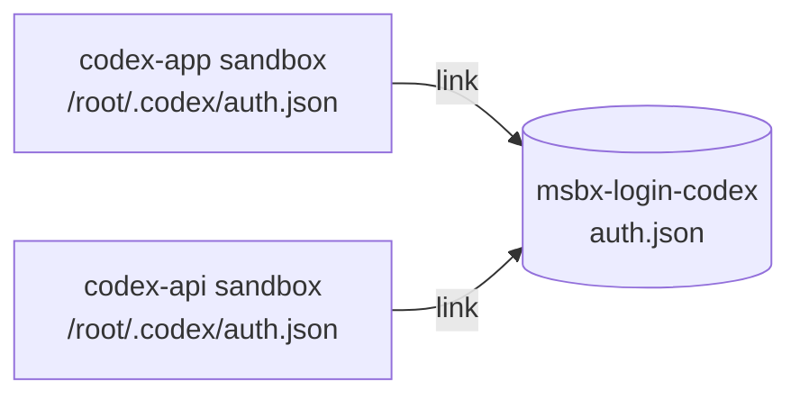

# RFC 0004: Shared agent logins

- Status: Implemented (agent scope)
- Tracking issue: [#9](https://github.com/finngi/msbx/issues/9)

The `agent` scope is implemented. The `project` and `off` scopes wait for the config file from
[RFC 0002](0002-config.md), since the scope is a setting. Checked for the pinned versions: Codex
0.148.0 rewrites `auth.json` in place (`OpenOptions` with `truncate` and `write`, no rename), and
pi 1.4.0 writes it in place under a lock file beside it, so the link survives both.

## Summary

Sign in to Codex or pi once, and all sandboxes for that agent are signed in. The login survives `msb rm` and recreating the sandbox. msbx keeps it in one microsandbox named volume per agent. Only the credential file is shared. Each sandbox has its own agent config, sessions and history.

API keys are unaffected. `OPENAI_API_KEY` on the host is still forwarded through microsandbox's secret proxy, so the key never enters the VM.

## Motivation

Codex "Sign in with ChatGPT" and pi subscription logins are stored per sandbox. Every new sandbox needs a fresh sign-in, and `msb rm` throws the login away. So recreating a sandbox, which is usually a cheap fix, costs you a browser login each time.

API keys already avoid this, since the secret proxy forwards them from the host, but people paying for a subscription want to use it instead. This change lets you sign in once per agent, which matches what Docker sbx users expect.

## Guide-level explanation

### First sign-in: Codex

1. Turn on device code sign-in in your ChatGPT security settings. For a workspace account, an admin enables it for the workspace.
2. Run `msbx agent codex -- login --device-auth` and enter the code it shows.
3. Run `msbx agent codex` in any project. It starts signed in.

Device code sign-in is needed because Codex's browser sign-in waits for a callback at `localhost:1455` in the VM, and the browser on your host can't reach it.

### First sign-in: pi

1. Run `msbx agent pi`, type `/login` and pick a provider.
2. When the browser cannot return to pi, paste the final redirect URL or the code into pi's prompt.
3. Every other pi sandbox now starts signed in.

### Signing out everywhere

1. Stop every sandbox for that agent: `msb stop <name>`.
2. Remove the login volume: `msbx volume rm msbx-login-codex` (msbx passes this to msb).
3. Run `msbx agent codex` and sign in again. msbx creates a new, empty login volume.

msb won't let you remove the volume while a sandbox that uses it is running. Signing out in one sandbox doesn't reliably sign you out of the others, so use these steps instead.

Sandboxes created before this feature don't get the login volume. Recreate them with `msb rm -f <name>`.

### Choosing a scope

Set the scope in `~/.config/msbx/config.toml`:

```toml
[defaults]
login = "agent"

[agents.codex]
login = "project"
```

| Scope | What is shared | Use it when |
|---|---|---|
| `agent` (default) | One login for all projects using that agent | You trust the repos you work on |
| `project` | One login per project sandbox, kept across `msb rm` | The repo is untrusted, or projects use different accounts |
| `off` | Nothing. The login lives in the VM and is lost on `msb rm` | Throwaway sandboxes |

A scope change applies to sandboxes created after the change.

## Reference-level explanation

- msbx creates a named volume `msbx-login-<agent>` the first time you run that agent, for example `msbx-login-codex`.
- The volume is mounted at `/root/.msbx-login` in each sandbox for that agent. Files on it cannot be executed.
- Each time msbx starts the agent, it links the agent's credential file to the volume:
  - Codex: `/root/.codex/auth.json`
  - pi: `/root/.pi/agent/auth.json`
- Both agents write that file in place, so a sign-in or a token refresh in one sandbox is seen by all of them.
- If an agent replaced the link with a regular file (for example after signing out and in again), msbx moves that file into the volume and restores the link.
- If the volume is missing when a sandbox starts (for example after a reset), msbx creates an empty one so the sandbox still starts.



Config files, sessions and history are all per-sandbox and are never written to the volume.

### Implementation notes

- `Agent.login: Option<Login>` with the guest directory and file name. `shell` has none.
- A pure function maps (agent, sandbox name, scope) to an optional volume name: `msbx-login-<agent>` for `agent`, `msbx-login-<sandbox>` for `project`, none for `off`.
- Use `Volume::get`, falling back to `Volume::builder(name).quota(16).label("msbx.agent", id).create()`. Treat `VolumeAlreadyExists` as success.
- Mount with `.volume("/root/.msbx-login", |m| m.named(name).noexec().nosuid().nodev())`.
- The SDK auto-creates named volumes only at sandbox create, but checks them on every start. `sandbox::start` must therefore ensure the volume as well as `ensure`.
- The quota is fixed once the volume exists. Changing the constant later breaks reuse of existing volumes.
- When bumping the pinned Codex or pi version, check the agent still writes its credential file in place. A temp file plus rename would replace the link.

## Drawbacks

The costs and trade-offs of this design are covered in the risk table under [Security](#security) and in [Rationale and alternatives](#rationale-and-alternatives).

## Security

- msbx shares one credential file per agent. Config, sessions, history and MCP server logins stay in each sandbox.
- The token is stored as plain JSON under `~/.microsandbox/volumes/<volume>/` on the host, readable only by your user account. This matches how Codex and pi store logins on Linux by default. Backups of your home folder include it.
- Inside the VM, the agent and anything it runs can read the token. This is true of any login made inside a sandbox. The secret proxy cannot hold Codex or pi logins today, because those agents read and refresh their tokens themselves.

| Risk | `agent` scope | `project` scope |
|---|---|---|
| A compromised sandbox reads the token | Yes | Yes, that project's login only |
| A compromised sandbox swaps in an attacker's token, so other projects send their code to the attacker's account | Possible | Limited to that project |
| A compromised sandbox plants a link in the volume to redirect writes | msbx removes it before linking | Same |
| Two sandboxes refresh the token at the same time | Codex re-reads the file and recovers. pi may sign you out | Not shared |

Advice:
- For repos you don't trust, use `project` or `off`.
- `/status` in Codex tells you which account is signed in. Check it if a sandbox acts strangely.
- If you suspect a sandbox was compromised, revoke the session from your provider account page, then follow "Signing out everywhere".

Claude Code, once added, will use the secret proxy and no volume. You run `claude setup-token` on the host and export `CLAUDE_CODE_OAUTH_TOKEN`, and msbx forwards it the same way as `OPENAI_API_KEY`, so the token never gets into the VM.

## Rationale and alternatives

- Named volume holding only the credential file (chosen): one volume per agent. Each sandbox links the agent's credential file into it. Sessions and config stay in the sandbox, so a compromised project cannot change another project's agent settings. It uses plain msb volumes, so `msb volume ls` and `msb volume rm` already handle listing and signing out everywhere.
- Token kept on the host and injected by the secret proxy (rejected for Codex and pi): the safest option, because the token never enters the VM. It cannot work today, because Codex reads its token locally and refreshes it itself, so new tokens would come back into the VM anyway. microsandbox cannot yet read secrets from a keychain or refresh OAuth tokens. It is the chosen path for Claude Code, whose `setup-token` gives a long-lived token that works with the proxy.
- Bind-mounting the host's `~/.codex` (rejected): every sandbox could rewrite your real Codex config, including MCP servers and hooks that run on your machine. Every sandbox would also see all your host sessions.
- Volume over the whole home or agent folder (rejected): simpler, but it shares sessions (which contain project code) and config between projects, so one bad repo could reach all of them.
- Doing nothing: users keep signing in again after every recreate, or copy `auth.json` into VMs by hand, which is less safe than a managed volume.

## Prior art

- [Docker sbx credentials](https://docs.docker.com/ai/sandboxes/security/credentials/): signs in to Codex on the host and keeps tokens in the OS keychain. A host proxy injects and refreshes them, and the sandbox sees only a placeholder. Global by default, with per-sandbox scope available. We take the "sign in once, global by default" experience and the scope option. Their host-side refresh needs upstream microsandbox work.
- [rikdc/ai-sandboxes](https://github.com/rikdc/ai-sandboxes) (Apache-2.0): one global `codex-home` volume per agent over the whole home, plus a short-lived tunnel for Codex's browser callback. We take the per-agent volume, narrowed to the credential file.
- [inoio/agents-sandbox](https://github.com/inoio/agents-sandbox) (GPL-3.0, ideas only, no code taken): home volume per project and agent, with the browser login callback passed into the VM. We take the idea of a per-project scope as an option.
- [ssadedin/microsandbox-ai](https://github.com/ssadedin/microsandbox-ai): Claude subscription through `claude setup-token`. The token is kept in the macOS Keychain and passed to msb as a secret, so the VM sees only a placeholder. We take this for Claude Code when it is added.

## Unresolved questions

- Two pi sandboxes refreshing a token at once may sign you out, because pi's file lock is per VM. Accept this, or point pi's agent folder at the volume?
- Can microsandbox forward a host port to the VM's localhost, so Codex's browser sign-in works without device code?
- Should msbx offer a one-off import of an existing host `~/.codex/auth.json` for workspaces where device code sign-in is disabled?
- Claude Code: does it accept the default `$MSB_` placeholder, or does it need a custom one shaped like its tokens? Does it need its onboarding state preset?
- Should MCP server logins ever be shared, and under which scope?
- Codex is pinned at 0.148.0, but the check that it writes `auth.json` in place was made against current Codex source. Re-check it on every version bump.

## Future possibilities

- Signing in on the host, as Docker sbx does (`sbx secret set openai --oauth`). That needs a secret proxy that can refresh OAuth tokens, which belongs in microsandbox upstream.
- Passing the browser's sign-in callback into the VM.
- Importing an existing host `~/.codex/auth.json`.
- Sharing MCP server logins, agent config or sessions.
- An msbx sign-out command. `msb volume rm` already does this.
