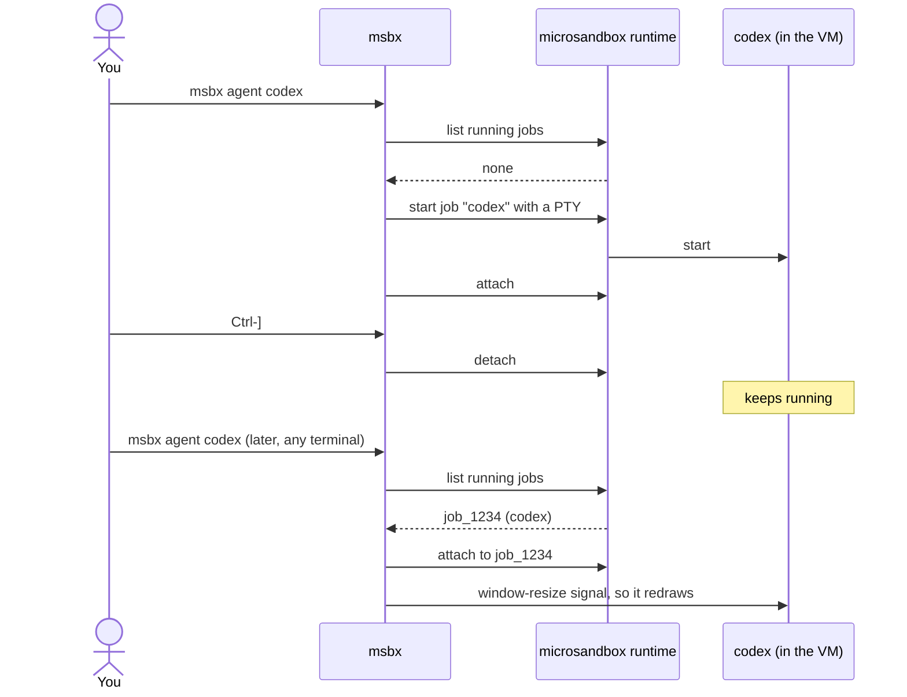

# RFC 0005: Detachable agent sessions

- Status: Proposed
- Tracking issue: [#10](https://github.com/finngi/msbx/issues/10)

## Summary

Today `msbx agent codex` runs the agent in your terminal. When you close the terminal, the agent shuts down, but its sandbox is still running. With this change the agent becomes a session in the sandbox that is independent of your terminal. Press Ctrl-] to keep it running (you can close the terminal too), then run `msbx agent codex` again or press Enter in the dashboard to pick up the same conversation.

## Motivation

Coding agents often run for many minutes on one task. Today `msbx agent` ties the agent to the terminal where it was started. So if you close that terminal, lose an SSH connection or quit the dashboard, the conversation ends, even though the sandbox keeps running.

Users have to keep a terminal open the entire time, or wrap the agent in their own tools. They should be able to leave an agent working and come back to it later, from any terminal or from the dashboard, the way `tmux` and `docker attach` work.

## Guide-level explanation

| You do | What happens |
|---|---|
| `msbx agent codex` | Attaches to the running Codex session for this project, or starts one if there is none |
| Ctrl-] | Detaches. The agent keeps running in the sandbox |
| Close the terminal | Same as detaching |
| `msbx agent codex --new` | Starts another session, even if one is already running |
| Enter on a card in `msbx` | Attaches to that sandbox's agent session, or starts one |
| `msbx jobs codex-myapp` | Lists running sessions (this is msb's `jobs` command) |
| `msbx kill --job ID codex-myapp` | Ends a session |
| `msbx attach --read-only --job ID codex-myapp` | Watches a session from a second terminal |

The last three are plain `msb` commands. msbx passes them through as they are.

Before attaching, msbx displays one line with the session ID and the detach key. When you detach, it tells you how to reattach and how to end the session. When the agent exits, msbx exits with the agent's exit code, and the next `msbx agent` starts a new session.

Ctrl-C is passed to the agent, as it is now. It never detaches.

Arguments after `--` are only used when a new session starts. If msbx attaches to a session that is already running, it tells you it ignored them.

In the dashboard, an agent card says `codex · session running` (or `codex · 2 sessions`), and the Enter hint is `↵ attach` or `↵ start`. The help popup shows Ctrl-]. The `x` key still opens a short-lived shell, as before.

## Reference-level explanation

microsandbox 0.7.11 supports managed jobs: commands that the sandbox runtime owns, independent of the terminal that started them. msbx launches the agent as a managed job with a terminal (PTY) and connects your terminal to it.

To find a session, msbx queries the runtime for jobs running in the sandbox and selects the most recent one whose program is the agent's command, for example `codex`. msbx keeps no state files and adds no labels.

When you reattach, msb does not replay old output. Right after attaching, msbx sends the agent a window-resize signal (SIGWINCH), so full-screen agents repaint their screen.

When the terminal closes, msbx sees the hangup signal and detaches before it exits, so you can attach again immediately.

### Implementation notes

- All SDK calls stay in `sandbox.rs`. Any attach, from the CLI or the TUI, runs only while the TUI is fully suspended.
- Start: `Sandbox::exec_detached_with(cmd, |o| o.args(..).tty(true))`, which returns a `Job`.
- Find: `SandboxHandle::list_jobs_with` (active jobs by default; follow `next_cursor`). Map each `JobInfo` to a plain `SessionInfo { id, program, created_at }`, because `JobInfo` is `#[non_exhaustive]` and cannot be built in tests. Pick a session with a pure `newest_session(&[SessionInfo], program)`.
- Attach: `SandboxHandle::get_job`, `Job::attach_with(|o| o.replay(JobReplay::None))`, `Job::signal(28)` (SIGWINCH), then `JobAttachment::interact_terminal()`. It returns `None` on Ctrl-] and `Some(code)` when the job exits. Run it in `tokio::select!` with SIGHUP and SIGTERM, and call `JobAttachment::detach()` on either signal.
- Errors: map `JobError::code() == "input_busy"` to the one-writer message. Report `JobError::LaunchUnconfirmed { id, .. }` with its ID and never retry it.
- Add `SandboxInfo.agent_sessions: usize` and the `AgentJob` and `SessionEnd` model types; add `--new` to the `agent` subcommand.
- Tests:
  - Unit tests for `newest_session`, `--new` parsing and messages.
  - Snapshots of cards with 0, 1 and 2 sessions.
  - An `#[ignore]` real-VM test: start, detach, find the same ID, reattach, check that output continues, check that a second writer gets `input_busy`, and check that stopping the sandbox clears the session.

## Drawbacks

- The dashboard has no "detached" indicator. The runtime reports only whether a session is running, so the card shows "session running".
- Sessions end when the VM stops. Stopping the sandbox (`s` in the dashboard, `msb stop`, or a host restart) ends its sessions, and the runtime does not restart them. The next `msbx agent` starts a fresh session. If your agent can resume an earlier conversation, pass its resume arguments after `--`.
- Only one terminal can write to a session at a time. If a session is already attached in another terminal, a second `msbx agent` fails with a message that shows the read-only command. If msbx is killed without a chance to detach (for example with `kill -9`), the runtime frees the session after about 30 seconds.
- Reattaching shows no scrollback. Full-screen agents redraw. A plain shell (`msbx agent shell`) shows nothing until it prints again; press Enter to get a prompt.
- The detach key is fixed at Ctrl-] by microsandbox.
- Finished sessions keep their output (up to about 1 MiB each) on disk until the sandbox is removed.
- A terminal is required. Sessions cannot be attached with redirected input.
- Detaching cleanly when the terminal closes is implemented for macOS and Linux only.

## Security

- Isolation is unchanged. The session runs in the same VM with the same user, mounts, network rules and secrets as `msbx agent` today.
- Anyone who can use your microsandbox runtime can attach, the same as for `msb exec` today.
- The sandbox's job history stores each session's command and arguments in plain text. Environment values are not stored. Do not pass secrets as agent arguments; use the host-side secrets msbx already sets up.
- A detached agent keeps working while nobody watches, with network access and write access to the project folder. End it with `msbx kill --job ID NAME`, or stop the sandbox.

## Rationale and alternatives

- microsandbox managed jobs through the SDK (chosen): the runtime already keeps a PTY process running with no client attached, limits input to one writer, and reports exit codes. The SDK gives msbx clear errors (for example "another terminal owns input") without parsing text output. msbx can also send a redraw signal right after attaching and detach cleanly when the terminal closes.
- Running `msb exec -d` and `msb attach` as child processes (rejected): closest to the "msbx only adds what msb lacks" rule, but msbx would have to parse the job ID from msb's output, it cannot trigger a redraw at the right moment (so reattaching often shows a blank screen), and when a terminal closes the session stays locked for about 30 seconds.
- tmux (or zellij) inside the VM (rejected): it would give scrollback, several attached clients and a configurable detach key. But it adds a package to every image and a second terminal layer whose prefix keys clash with agent shortcuts, needs session naming msbx would have to manage, and duplicates what the runtime already provides. Sessions would still end when the VM stops.
- Our own state file of session IDs (rejected): the runtime can already list running jobs, and a separate file can go stale.
- Doing nothing: agents keep dying with their terminal. Users who know about `msb exec -d` can manage jobs by hand; everyone else loses work.

## Prior art

- [tmux](https://man7.org/linux/man-pages/man1/tmux.1.html): a server process owns the sessions; clients attach and detach. `attach -d` takes over from other clients, and `-r` attaches read-only. We take the session that outlives its terminal, and the read-only watcher. Takeover would need runtime support that microsandbox doesn't have.
- [docker attach](https://docs.docker.com/reference/cli/docker/container/attach/): detaches with Ctrl-P Ctrl-Q, configurable with `--detach-keys`, several clients at once, no history replay. We take the "one key to detach, the process keeps running" model.
- [inoio/agents-sandbox](https://inoio.github.io/agents-sandbox/how-it-works.html) (GPL-3.0, ideas only, no code): runs an agent server inside the VM that several clients can attach to. This confirms that users want to come back to a running agent, but it depends on agents having a client/server mode, which ours lack.
- [billroy/hoosegow](https://github.com/billroy/hoosegow) (MIT): its server owns the PTYs, and on reconnect it lists them, rejoins them and replays limited scrollback. We take "find the running session and rejoin it". Scrollback replay can come later.

## Unresolved questions

- Is SIGWINCH enough to make each agent redraw on reattach? This needs checking against real Codex and pi in a VM.
- Should a plain shell session replay a little recent output, since it does not redraw?
- Should stopping a sandbox from the dashboard ask for confirmation when it has a running session?
- After a VM restart, should `msbx agent` point users to their agent's resume arguments, or stay agent-neutral?
- Finished sessions keep up to about 1 MiB of output each until the sandbox is removed. Do we need a way to prune them, and should that go upstream?
- Should we propose an "attached clients" count upstream, so the dashboard can show "detached"?

## Future possibilities

- Showing whether a session is attached. This needs runtime support, so it should be proposed upstream.
- A configurable detach key.
- Taking over a session attached elsewhere, like `tmux attach -d`. The runtime has no way to do this.
- Replaying scrollback on reattach.
- Asking for confirmation before stopping a sandbox that has a running session.
- Removing old session history.
