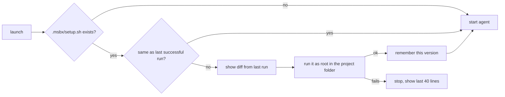

# RFC 0006: Per-project setup script

- Status: Proposed
- Tracking issue: [#11](https://github.com/finngi/msbx/issues/11)

## Summary

A project can ship a `.msbx/setup.sh`. msbx runs it in the sandbox after the agent is installed, and runs it again if the file changes. A new sandbox then gets your project's toolchain automatically, without you doing anything.

## Motivation

A fresh sandbox has only the base image and the agent. But each project needs its own tools, so every time you recreate a sandbox you have to install them by hand again. That is slow, and the result varies from sandbox to sandbox.

A script committed with the project lets a fresh sandbox be ready to go on first launch, and keeps it up to date when the script changes.

## Guide-level explanation

- Put your setup steps in `.msbx/setup.sh`: apt packages, language toolchains, `mise install`, anything a shell can do.
- It runs on the first `msbx agent` launch, and on later launches only if the file changed.
- You see its output live.
- If it fails, the agent does not start: you get the exit code and the last 40 lines of output. The next launch tries again.
- When the file has changed since the last run, msbx shows the diff before running it.

## Reference-level explanation



- msbx copies the script inside the VM and runs the copy with `bash`, as root, in the project folder.
- On success, the copy is kept as the "last successful run".
- Comparing against that copy is how msbx knows the file changed, so it never hashes the file.
- Running a copy means an edit made while the script runs cannot slip in.

Example using mise, which many projects already use for tool versions:

```sh
# .msbx/setup.sh
set -e
curl -fsSL https://mise.run | MISE_INSTALL_PATH=/usr/local/bin/mise sh
mise trust --yes && mise install
ln -sf "$(mise where node)"/bin/* /usr/local/bin/   # put tools on PATH for the agent
```

To force a re-run, delete the marker; msbx passes the command to msb:

```sh
msbx exec codex-myapp -- rm /root/.msbx-setup.done
```

To disable it for all projects, add `setup = false` to `~/.config/msbx/config.toml`. To use a different path, set `setup = "tools/sandbox-setup.sh"`.

### Implementation notes

- `sandbox::setup_once(sandbox, project, name)` runs after `install_once` in `ensure`.
- `setup_script(project) -> String` builds the guest command:
  1. copy to `/root/.msbx-setup.pending`
  2. `cmp -s` against `/root/.msbx-setup.done`
  3. `diff -u` when different
  4. `bash` the pending copy
  5. `mv` to done on success.
- Quote the project path; paths can contain spaces and quotes.
- Stream output with the SDK's `shell_stream_with` and `ExecHandle::recv`, and keep the output for the error tail (reuse `last_lines`).
- TUI Enter on an existing sandbox should go through `ensure` too, so script changes apply there.
- Config key `setup` (string path, or `false`).
- Tests:
  - unit tests for script building and quoting
  - a `#[ignore]` real-VM test: the script runs once, runs again after an edit, and a failing script blocks the launch and retries next time.

## Drawbacks

- One script per project, run with `bash`. A shebang line is ignored.
- It runs on launches through `msbx agent` and the TUI. It does not run if you `msb exec` into the sandbox directly.
- Removing the script does not undo what it installed. Remove the sandbox with `msb rm -f NAME` for a clean start.
- msbx does not read `devcontainer.json`, and does not run `mise install` on its own.

## Security

- The script comes from the repository, so in a cloned repository someone else wrote it.
- It runs only inside the VM, with the same access the agent already has there: root, with the same network. msbx therefore does not ask for confirmation.
- msbx shows the diff whenever the script changes, so you can see what an agent or a pull changed.
- msbx never runs anything from `.msbx/` on your Mac. This is also why it does not support devcontainer's `initializeCommand`, which runs on the host.

## Rationale and alternatives

- **`.msbx/setup.sh` (chosen):** one plain shell script that can do anything: apt, mise, language toolchains. It re-runs only when its content changes, which msbx detects by comparing against the copy kept from the last successful run. No new dependencies.
- **`devcontainer.json` (rejected):** the spec is large, and partial support would confuse users. Its `initializeCommand` runs on the host, which msbx must never do.
- **Automatic `mise install` (rejected for now):** msbx would have to install and pin mise in the VM and put its tools on the agent's PATH, and some tools need build dependencies. A project can call mise from `setup.sh` instead (README recipe). We may revisit after real use.
- **Configured in the repository (rejected):** settings stay user-level in `~/.config/msbx/config.toml`. The only per-project file is the script.
- **Not doing it:** users keep reinstalling toolchains by hand, and sandboxes drift apart.

## Prior art

- [ssadedin/microsandbox-ai](https://github.com/ssadedin/microsandbox-ai): `.msb-agent/setup.sh`, re-run when its content changes, and a failure stops the launch. No licence, so ideas only.
- [singh-ramanpreet/sandboxed-agents](https://github.com/singh-ramanpreet/sandboxed-agents): `.sbxag/setup.sh` as root plus `setup-user.sh` as the user. No licence stated, so ideas only.
- [Dev Container spec](https://containers.dev/implementors/json_reference/) lifecycle commands (`onCreateCommand`, `postCreateCommand`, and the host-side `initializeCommand`).
- [inoio/agents-sandbox](https://github.com/inoio/agents-sandbox): provisioning and startup hooks in its config. GPL-3.0, so ideas only.
- [mise](https://mise.jdx.dev/cli/trust.html): per-project tool versions, and its trust model.

## Unresolved questions

- Should the script run as root, or as the image's `node` user with sudo?
- Should the agent install stream its output the same way, for consistency?
- Is the mise recipe's PATH step (symlinking tools into `/usr/local/bin`) reliable enough to document, or should msbx put mise's shims folder on PATH?
- Should failures be retried automatically, or only on the next launch (current proposal)?

## Future possibilities

- Reading `devcontainer.json` (`onCreateCommand`, `postCreateCommand`).
- Running `mise install` automatically when a project has `mise.toml`. We may add this after trying the script recipe on real projects.
- A `--setup` flag to force a re-run.
- Setup status on TUI cards.
- A per-user script that applies to every project.
