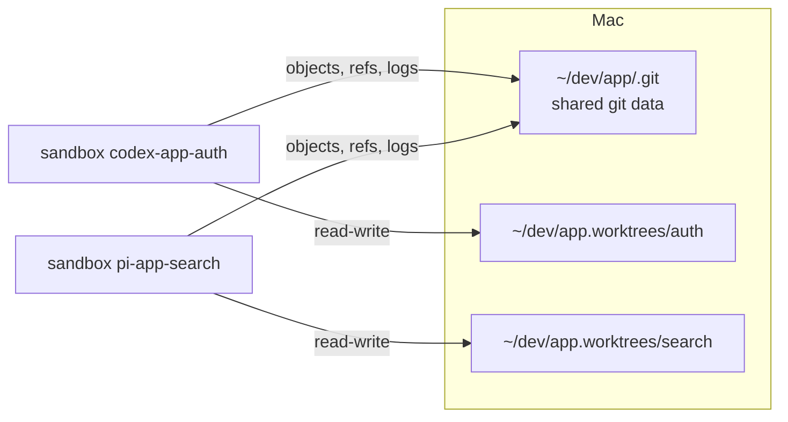

# RFC 0007: Parallel agents with git worktrees

- Status: Proposed
- Tracking issue: [#12](https://github.com/finngi/msbx/issues/12)

## Summary

Run two or more agents on the same repo at once. Each gets its own git worktree, own branch and own sandbox, so each works on its own files. Their commits show up in your repo right away.

```sh
msbx agent codex --worktree auth     # codex on branch msbx/auth
msbx agent pi --worktree search      # pi on branch msbx/search, at the same time
```

## Motivation

Running two agents on one repository today means one checkout and overwritten work. With git worktrees, each agent gets its own folder and branch, while sharing history. Today msbx mounts only the worktree folder, so git fails inside the VM when you point msbx at a worktree.

Making worktrees work, and adding `--worktree NAME` to create one, gives users parallel agents whose commits they see on the host straight away.

## Guide-level explanation

- `--worktree NAME` (or `-w NAME`):
  - creates `<parent>/<repo>.worktrees/NAME` on branch `msbx/NAME`, starting from your current commit
  - starts the sandbox `<agent>-<repo>-NAME`.
- Running the same command again reuses the worktree, the branch and the sandbox.
- `msbx agent codex PATH` also works when PATH is a worktree you created yourself with `git worktree add`. Today git does not work inside the VM in that case.
- The TUI shows the branch on each card, for example `codex · msbx/auth`.
- Worktree sandboxes cannot change your git hooks or git config (see [RFC 0001](0001-git-safety.md)).

## Reference-level explanation



A worktree's own folder has only a `.git` file pointing into the `.git` in the main repo's folder, so the VM needs both. msbx mounts each in the same place as on your Mac, so every path git saves still works in the VM:

| Path | Mode | Why |
|---|---|---|
| `~/dev/app.worktrees/auth` | read-write | the agent's files |
| `~/dev/app/.git` | read-only | shared config and hooks must not change |
| `~/dev/app/.git/objects` | read-write | commits write objects |
| `~/dev/app/.git/refs` and `logs` | read-write | commits move the branch and write the reflog |
| `~/dev/app/.git/reftable` (if present) | read-write | the same, for repositories using the reftable format |
| `~/dev/app/.git/worktrees/auth` | read-write | this worktree's HEAD and index |

- The worktree is created on your Mac with hooks turned off and without a checkout. The files are checked out inside the VM, so filters such as Git LFS run there.
- Worktrees live next to the repository, outside its folder. A sandbox on the main checkout therefore cannot touch them, and editors and search tools index the files only once.

### Implementation notes

- New module `worktree.rs`. It is host only and never imports the SDK.
- `linked_git(path) -> Option<LinkedGit>` reads the `.git` file and `commondir` directly, without running git.
- `add(repo, name) -> PathBuf` runs `git worktree add --no-checkout` through the hardened helper from [RFC 0001](0001-git-safety.md).
- `ensure` takes a `Workspace { path, name, git }`:
  - adds the read-only common mount and the read-write child mounts (the SDK mounts parents first)
  - runs `git reset --hard -q` in the VM once, when the worktree has no index yet.
- Guest env at create: `GIT_CONFIG_COUNT` with `gc.auto=0`, `maintenance.auto=false`, `safe.directory=*`.
- Label `msbx.worktree`. The TUI reads the branch from the HEAD file on refresh.
- Config keys: `worktree.dir`, `worktree.branch`, `worktree.base`.
- Tests:
  - unit tests for `.git` file parsing (absolute, relative, CRLF), naming and HEAD parsing
  - a `#[ignore]` real-VM test: commit in a worktree sandbox and see it on the host with `git log msbx/it`; a hook write fails in the VM.

## Drawbacks

- msbx never deletes a worktree. When you are done, run `git worktree remove ~/dev/app.worktrees/auth`.
- Inside the VM, commands that write git config fail by design: `git config`, `git push -u`, and deleting branches that are packed. Automatic `git gc` is turned off there.
- Refs are writable, so an agent can move any branch. Check `git reflog` if a branch looks wrong.
- Submodules are not supported. msbx warns that git may not work inside the VM.
- msbx refuses `--worktree` when the repository uses per-worktree config (`extensions.worktreeConfig`). That file would be writable from the VM.

## Security

- Worktree runs are safer than normal runs. Hooks and config live in the read-only part, and your Mac enforces the read-only mode, outside the VM's reach.
- The worktree's `.git` file and the small pointer files in `.git/worktrees/NAME` stay writable. An agent could aim them at a git folder it planted. The guard check compares them against the values msbx expects and warns after each session.
- A sandbox on the main checkout still has full write access to `.git`.

## Rationale and alternatives

- Sibling folder `<parent>/<repo>.worktrees/<name>` (chosen): visible, needs no `.gitignore` entry, and matches git's own `../` examples. It sits outside the main checkout, so a sandbox there cannot tamper with it, and tools index the files only once.
- `.msbx/worktrees` inside the repository (rejected): this is the convention Claude Code uses (`.claude/worktrees`). But the main checkout's sandbox could edit every worktree's git pointer files, and it needs `.gitignore` entries.
- `~/.msbx/worktrees` (rejected): keeps the repository clean, but puts the files far from the repository and needs unique naming.
- Checkout inside the VM (chosen) or on the host: a checkout on the host runs filter drivers, and `post-checkout` hooks, from the repository's config. msbx creates the worktree on the host without a checkout, with hooks off, and checks out in the VM.
- Read-only shared `.git` with writable objects, refs and logs (chosen): commits work, and hooks and config cannot change.
- Doing nothing: parallel agents stay impractical, and running msbx in a worktree stays broken.

## Prior art

- [git-worktree documentation](https://git-scm.com/docs/git-worktree): what is per worktree (HEAD, index) and what is shared (refs, config). Also `extensions.worktreeConfig` and `worktree.useRelativePaths`.
- [Claude Code `--worktree`](https://code.claude.com/docs/en/worktrees.md): `.claude/worktrees/<name>`, branch `worktree-<name>`, a prompt before deleting work.
- [inoio/agents-sandbox issue #426](https://github.com/inoio/agents-sandbox/issues/426): a linked worktree's shared git folder is not mounted, so git fails in the VM. GPL-3.0, so ideas only.
- [ssadedin/microsandbox-ai](https://github.com/ssadedin/microsandbox-ai): mounts the main repository's git data at its host path for linked worktrees. No licence, so ideas only.
- [Codex](https://developers.openai.com/codex/concepts/sandboxing): protects the `gitdir:` target of worktrees as read-only.

## Unresolved questions

- Does the VM report host-owned files so that git's "dubious ownership" check fires? If so, `safe.directory=*` in the guest env fixes it.
- Does the VM create mount points when the main repository folder itself is not mounted?
- Should `--worktree NAME:BASE` (start from another branch) come later?
- Should removing a worktree sandbox offer to remove a clean worktree, as Claude Code does?
- Should agents be allowed to move only their own `msbx/<name>` branch? Today refs are writable for all branches.

## Future possibilities

- Automatic cleanup of worktrees or branches.
- A `NAME:BASE` syntax to start from another branch. Check out the base first.
- Creating worktrees from the TUI.
- Keeping the repository only inside the VM.
