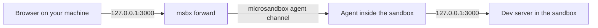

# RFC 0009: Ports: open servers running in a sandbox

- Status: Proposed
- Tracking issue: [#14](https://github.com/finngi/msbx/issues/14)

## Summary

Press `p` on a sandbox for a list of the ports its programs are listening on. Press `f` to forward one to the same port on your machine's 127.0.0.1. Forwards work right away, with no restart, and stop when you exit msbx. The Overview tab also lists the sandbox's published ports.

## Motivation

Agents often start a dev server inside the sandbox, and the user then wants to open it in a browser. The only built-in way, publishing a port with `msb modify`, needs a restart, and restarting stops the agent and the server you're publishing.

Published ports also can't reach servers bound only to localhost in the sandbox, which is how a lot of dev servers are set up by default. A live forward from the TUI is a one-key fix for the common case.

## Guide-level explanation

- An Overview "ports" row listing published ports, such as `127.0.0.1:8080 → 80`. It adds "(restart pending)" when a change is saved but not yet active.
- A ports popup:

```text
╭─ Ports · codex-api ────────────────────────────╮
│  Guest   Bind        Host                      │
│  3000    127.0.0.1   → 127.0.0.1:3000 (fwd)    │
│  5432    0.0.0.0     —                         │
│                                                │
│  Permanent: msbx modify codex-api -p 5432:5432 │
│             --restart  (restarts the VM)       │
│  ↑↓ select  f forward  u stop  esc close       │
╰────────────────────────────────────────────────╯
```

For example, the agent launches a dev server on port 3000. You press `p`, then `f`, and open http://localhost:3000 in your browser.

## Reference-level explanation



- Listing: when you open the popup, msbx runs `cat /proc/net/tcp /proc/net/tcp6` in the sandbox and keeps the sockets that are listening.
- Forwarding: msbx listens on 127.0.0.1 on your machine, using the same port number as in the sandbox. If that port is taken, the OS picks a free one and the popup shows it. Each connection is passed through microsandbox's agent inside the sandbox to 127.0.0.1 at that port.
- Forwards don't go through the sandbox's network, so the network policy doesn't apply. Servers that only listen on localhost inside the sandbox work too.
- Forwards keep running while you are attached to the agent or a shell. They stop when msbx quits.

### Forward or publish?

| | Forward (`f` in msbx) | Publish (`msbx modify -p … --restart`) |
|---|---|---|
| Takes effect | Immediately | After the sandbox restarts |
| Restart stops the agent and servers | No | Yes |
| Reaches servers on the sandbox's 127.0.0.1 | Yes | No |
| Lasts after msbx quits | No | Yes |
| Lasts after the sandbox restarts | No | Yes |
| Address on your machine | 127.0.0.1 only | 127.0.0.1 by default, can be changed |

Publishing needs no new msbx command, because `msbx modify` is passed straight to `msb`:

```text
msbx modify codex-api -p 8080:80 --restart
msbx modify codex-api --port-rm 8080 --restart
```

If you want the change to apply the next time the sandbox starts, replace `--restart` with `--next-start`.

### Implementation notes

- `sandbox::listeners(name) -> Result<Vec<Listener>>`: `Sandbox::get(name)`, then `.connect()`, `shell(...)` and `.detach().await`. Keep `parse_proc_net(&str) -> Vec<Listener { port, loopback }>` pure: LISTEN state `0A`, deduplicated, sorted.
- `sandbox::forward(name, guest) -> Result<Forwarding { host_port, task }>`. `Forwarding` aborts its task when dropped. `tui.rs` owns the forwards; `app.rs` holds plain `(name, guest, host)` tuples for rendering.
- Tunnel: `Sandbox::client_arc()`, then `AgentClient::stream(MessageType::TcpConnect, &TcpConnect { host: "127.0.0.1", port, bulk: None })`, then `TcpData` and `TcpEof`. `client_arc()` is local only and panics on a cloud sandbox, so check `local()` first. Prior art: skalenetwork/microsandbox-reef `agent forward` (MIT).
- Published ports come from `SandboxConfig.spec.network.ports`. A change is pending when they differ from `handle.active_config()`.
- Add tokio's `net` feature for `TcpListener`.

## Drawbacks

- Publishing a port needs a restart. That stops the sandbox, which ends the agent session and every process inside it, including the server you wanted to publish.
- A published port connects to the sandbox's network address, so it can't reach servers that listen only on localhost. Many dev servers, Vite among them, do that by default. Use a forward instead, or start the server with `--host 0.0.0.0`.
- Forwards are TCP only. They stop when msbx quits and are not recreated after the sandbox restarts.
- The port list shows every listening port in the sandbox, without the program that opened it.
- Forwarding uses microsandbox's internal agent protocol, which can change between releases. msbx pins its microsandbox version for this reason.

## Security

- msbx forwards only on 127.0.0.1, so other machines on your network can't reach a forward. If a published port is bound to anything other than 127.0.0.1, Overview shows it in red.
- Any program on your machine can connect to a forwarded port, as with any local dev server. On a shared machine, that includes other users.
- A sandbox with `host = true` can reach your machine's 127.0.0.1, so it can reach your forwards and published ports, including another sandbox's. Set `host = false` for sandboxes that don't need it.
- If the port is already in use, msbx leaves it alone and uses a free port chosen by the OS.

## Rationale and alternatives

- Live forward (chosen): works immediately, needs no restart, and reaches servers on the sandbox's localhost. Its costs are that it stops when msbx quits and relies on microsandbox's internal agent protocol, which is why we pin the version.
- Publish with restart, from the TUI: it lasts, but stops everything running in the sandbox and can't reach localhost-only servers. It already exists as `msbx modify -p … --restart`, so a TUI button would add little.
- A relay such as socat or nc inside the sandbox: this still needs a published port (so still a restart), or one `msb exec` process per connection. It also needs a tool that the base image does not include.
- Showing the ports in Overview: cheap, and it tells users what is already published and whether a restart is pending.
- Doing nothing: users have to restart sandboxes, losing agent sessions, or tell the agent to restart its server on 0.0.0.0, and still can't reach localhost-only servers.

## Prior art

- [kubectl port-forward](https://kubernetes.io/docs/reference/kubectl/generated/kubectl_port-forward/): a temporary localhost tunnel into a running workload that lasts while the command runs. It is the model for our forward.
- [skalenetwork/microsandbox-reef](https://github.com/skalenetwork/microsandbox-reef) (MIT): `agent forward` reads listening ports from `/proc/net/tcp` and tunnels connections through the microsandbox agent with TcpConnect. It is the closest match, and its licence allows reuse.
- [Freudenjunge/microsandbox-tui](https://github.com/Freudenjunge/microsandbox-tui): has a ports tab. Its licence is unclear, so ideas only.
- [Docker sbx](https://docs.docker.com/ai/sandboxes/usage/): its usage docs describe a network panel, but no port forwarding.

## Unresolved questions

- Should forwards be remembered and recreated the next time msbx starts, or stay strictly per session?
- When the same port is taken on the host, should we try the next ports up, or let the OS pick one?
- Should we warn when a listener is bound only to the sandbox's localhost and the user tries to publish it when a forward would work?
- How stable is TcpConnect across microsandbox releases, and is it worth asking upstream for a supported port-forward API?
- Is there demand for UDP forwards?

## Future possibilities

- Publishing or unpublishing from the TUI, because it means a restart. Use `msbx modify`.
- Forwarding UDP.
- Forwarding new listeners automatically.
- Keeping forwards running after msbx quits, which would need a background service.
- Showing which program owns each port.
- A new CLI command. `msbx modify` already covers publishing.
