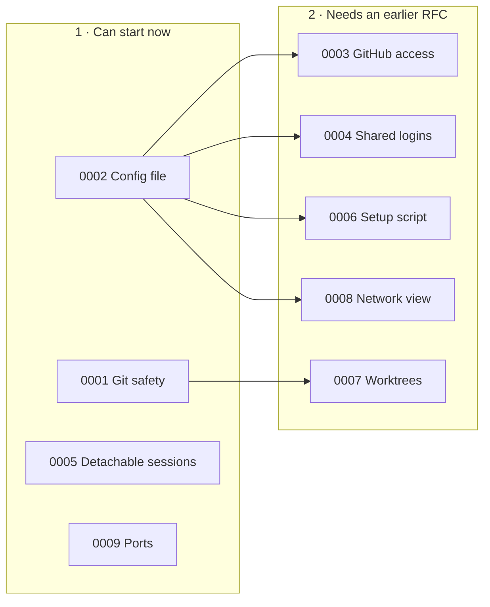

# RFCs

These pages are proposals for msbx's next features. Each feature has its own page and tracking issue. Comment on the issues before or during the work.

msbx stays a thin layer on top of microsandbox. A feature goes in msbx only if `msb` doesn't already do it, and any unknown command is still passed straight to `msb`.

## Process

1. Copy [`0000-template.md`](0000-template.md) to `docs/src/rfcs/NNNN-short-name.md`, using the
   next free number, and add it to `docs/src/SUMMARY.md`.
2. Open a pull request with the RFC alone, linking a tracking issue in its metadata
   (`- Tracking issue: #N`).
3. Discussion happens on the pull request. Update the RFC as it changes.
4. When accepted, the RFC is merged with `- Status: Accepted` and implementation follows in
   separate pull requests. A declined RFC may be merged with `- Status: Declined` to record the
   decision.

Each RFC starts with a short metadata list:

```markdown
- Status: Proposed
- Tracking issue: #N
```

## Order

| RFC | Feature | What you get | Depends on |
|---|---|---|---|
| 0001 | [Git safety](0001-git-safety.md) | An agent can't use your repo's `.git` to run code on your Mac without you noticing | none |
| 0002 | [Config file](0002-config.md) | One `~/.config/msbx/config.toml` for defaults and per-project settings | none |
| 0003 | [GitHub access](0003-github-access.md) | Agents can `git push` and `pull` with a repo-scoped token that never enters the VM | 0002 |
| 0004 | [Shared logins](0004-shared-logins.md) | Sign in to Codex or pi once, reuse it in every project | 0002 |
| 0005 | [Detachable sessions](0005-detachable-sessions.md) | Close the terminal, the agent keeps working; reattach later | none |
| 0006 | [Setup script](0006-setup-script.md) | `.msbx/setup.sh` installs a project's tools in its sandbox, re-run when it changes | 0002 |
| 0007 | [Worktrees](0007-worktrees.md) | Several agents on one repo at once, each on its own branch | 0001 |
| 0008 | [Network](0008-network.md) (implemented) | Allow and deny hosts per sandbox, live, through the msbx proxy; see what was blocked | none |
| 0009 | [Ports](0009-ports.md) | Open a dev server running in the sandbox from your browser, without restarting it | none |
| 0010 | [Dashboard](0010-dashboard.md) | Consistent pane navigation, a create wizard and network inspection and rule editing | 0008 |
| 0011 | [Host ports, info and settings](0011-info-settings.md) (implemented) | Choose which Mac ports new sandboxes reach; `i` shows a sandbox's details; `Ctrl-S` edits the defaults | 0008, 0010 |



## Decisions so far

- Config lives only in your home folder. A per-repo config file would let an agent change its own settings, because it can write to the project folder.
- msbx never stores secrets. Config names environment variables. microsandbox reads the value when a sandbox starts and swaps it in on the way out, so the VM only sees a placeholder.
- Logins are shared per agent by default. You can switch to per project, or off, for repos you don't trust.
- Agent sessions attach through the microsandbox SDK while the dashboard is suspended. This gives a clean redraw on reattach and frees the session straight away when a terminal closes.
- Ports are forwarded live while msbx is open. This uses a lower-level microsandbox API, which is safe to rely on because msbx pins an exact microsandbox version.

## What we checked

Every page is based on reading the microsandbox 0.7.11 source as well as its docs, and on studying the other open-source tools built on microsandbox. Where microsandbox can't do something yet (say, logging allowed connections, or changing a running sandbox's network policy), the page says so and does not work around it.
